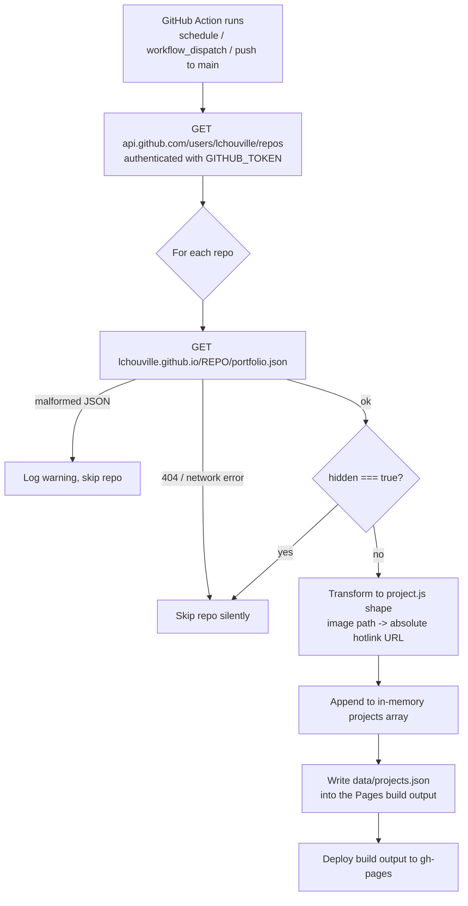

# Project auto-discovery (replacing hand-edited `data/projects.json`)

Status: validated, ready for implementation.

## 1. Goal & scope

**Replaces**: the manual maintenance of `data/projects.json`. Today Luka hand-edits this file every time a project is added, updated or removed.

**After this change, nothing in MyPortfolio needs manual editing when a project changes.** All project data and visibility (`hidden`) live in each project's own `portfolio.json`, published on that project's own `gh-pages` (see `.claude/rules/docs.md`). MyPortfolio only aggregates what it finds.

**Stays manual**: nothing project-related. The only manual action left is tagging a release (`vX.Y.Z`) in each project repo, which already triggers that repo's own CI to publish/update its `portfolio.json` — that step already exists per `cicd.md` and isn't part of this design.

## 2. Data flow

Step by step:

1. A GitHub Action in MyPortfolio runs (trigger details in section 6).
2. It calls `GET /users/lchouville/repos` once (paginated if needed) using the Action's built-in `GITHUB_TOKEN` as a Bearer token, purely to raise the rate limit (see section 5) — the response only ever contains public repos regardless of the token.
3. For each repo name, it fetches `https://lchouville.github.io/<repo>/portfolio.json` with a plain HTTPS GET (this is a static Pages file, not a GitHub API call — it isn't subject to the API rate limit).
4. A missing file (any non-2xx, mainly 404 because the repo has no `gh-pages` or no `portfolio.json` at its root) means "no portfolio data for this repo" and is silently skipped — expected, not an error.
5. A response that fails `JSON.parse` is a real misconfiguration in that other repo; log a warning but skip and keep going (one bad repo must never fail the whole run).
6. `hidden: true` → skip, before the project ever reaches `data/projects.json`.
7. Everything else is transformed (see section 3) into the shape `js/init/project.js` already expects.
8. The resulting array is written to `data/projects.json` inside the static site's build/staging output for this run — not committed to `develop`/`main` (see section 7).
9. That output is deployed to `gh-pages` the same way the rest of the static site already is.

**Images: hotlink, not download.** The transform step rewrites each image path to an absolute URL on the source repo's own `gh-pages` (e.g. `https://lchouville.github.io/<repo>/data/images/cover.png`) instead of downloading the binary and committing/deploying a local copy.

Why hotlink:
- Zero new code to download files, rewrite local paths and manage a growing `data/images/` folder of files MyPortfolio doesn't own.
- No duplicated storage/bandwidth across two gh-pages (lighter, consistent with éco-conception: don't copy bytes that already have a stable public home).
- Each project is already a hard dependency on its own `gh-pages` being reachable (that's how its `portfolio.json` is fetched in the first place) — depending on the same host for its screenshot adds no new failure mode. Worst case (image later moved/deleted while `portfolio.json` itself still resolves) is a single broken ``, the same class of failure the hand-edited file already risked with a wrong path.

## 3. Mapping: upstream `portfolio.json` → `js/init/project.js` shape

**Recommendation: transform at CI time in MyPortfolio, don't change `project.js`.**

Why: `project.js` is simple, stable, French-only rendering code with no i18n, no stack/tags/links UI. Teaching it to understand a richer bilingual schema (`description.fr`/`.en`, `stack`, `tags`, `links.*`) would mean adding a language switcher and new card UI — a much bigger, unrelated change that isn't part of "stop hand-editing a JSON file." Flattening upstream data down to the shape the renderer already consumes is strictly less code and changes nothing visible on the site today. If Luka later wants stack badges, tags or a language toggle on project cards, that's a separate `design-web`/`conception` task, not a side effect of this one.

| `project.js` / `projects.json` field | Comes from upstream `portfolio.json` | Notes |
|---|---|---|
| `name` | `name` | direct |
| `description` | `description.fr` | site has no i18n (confirmed: `index.html` is `lang="fr"`, no language toggle) — `description.en` is simply dropped |
| `repository` | `links.repo` | direct |
| `access` | `links.demo` | direct; `null` if absent, same as today |
| `image` | first entry of `images` (screenshot), rewritten to an absolute hotlink URL on the source repo's `gh-pages` | see section 2 |
| `techno` | `stack` | **note**: today's `data/projects.json` has no project ever carrying `techno`, so the tag row in the card is currently always empty — this is a pre-existing gap, not something this design breaks. Auto-discovery will actually start populating it. |
| `status` | `progress` (new field, see decision below) | `"completed"`→"Terminé", `"in-progress"`→"En cours", `"paused"`→"En pause", `"cancelled"`→"Annulé". Missing/empty `progress` → "En pause" (explicit default, decided by Luka: an unmaintained schema field defaults to the least-committal lifecycle state). |
| `competences.hard_skills` | `stack` (reused) | reasonable default: a tech stack is a fair proxy for hard skills |
| `competences.soft_skills` | `softSkills` (new optional field, see decision below) | missing/empty → `[]`, no value inferred |

## 4. Hidden/excluded projects

Confirmed convention: a `"hidden": true` field inside a project's own `portfolio.json` (owned and edited only in that project's repo). The CI aggregation step in MyPortfolio checks it right after parsing (step 6 in section 2) and simply never adds that project to the in-memory array — it never reaches `data/projects.json`, so there is no secondary exclusion list to maintain in MyPortfolio.

## 5. Failure handling

| Case | Handling |
|---|---|
| Repo has no `gh-pages` branch at all | `portfolio.json` fetch 404s → silent skip |
| Repo has `gh-pages` but no `portfolio.json` at root | same 404 → silent skip |
| `portfolio.json` exists but isn't valid JSON | `JSON.parse` throws → log a warning (real misconfiguration worth noticing), skip that repo, continue with the rest |
| Transient network failure fetching one repo's file | no retry — simplest option for a personal project on a daily/weekly cron; that project is just missing from this run and reappears on the next scheduled run (acceptable staleness window) |
| GitHub REST API rate limit (listing repos) | unauthenticated limit is 60 req/hour; always send the Action's built-in `GITHUB_TOKEN` as a Bearer token on the `GET /users/lchouville/repos` call to get the authenticated 5000 req/hour limit instead — costs nothing (the token is already available for free in any GitHub Action), removes any future headroom concern as the repo count grows, and doesn't change what the endpoint returns (still public repos only). One run also only ever calls this endpoint once or twice (pagination), well under either limit even at 60/hour for Luka's repo count — the token is cheap insurance, not a response to an actual current problem. |

## 6. Trigger & frequency

Recommended triggers on the aggregation step (combined with the existing GitHub Pages deploy workflow from `cicd.md`, not a separate pipeline):
- `workflow_dispatch` — manual "refresh now" button, e.g. right after tagging a new project release.
- `schedule` (daily cron) — keeps the portfolio reasonably fresh without Luka remembering to trigger it; cheap at this scale (one Action run with a handful of HTTP calls).
- Existing push-to-`main` trigger of the Pages deploy — refreshing project data for free whenever the site itself is redeployed.
- **Optional, not designed now**: `repository_dispatch` — other project repos' own release workflows could call this to trigger an immediate refresh instead of waiting for the next schedule. Left as a future option; wiring it up across repos (shared token/permissions) is its own small task, not needed for this design to work.

## 7. Where the generated files live

**Recommendation: `data/projects.json` is generated fresh into the `gh-pages` build output only. It is never committed to `develop` or `main`.**

This matches the existing rule in `cicd.md`: what reaches `gh-pages` is compiled/generated output, never hand-edited — and `portfolio.json` itself already follows this exact pattern on every other repo (CI-generated on tag, never hand-edited on `gh-pages`). Concretely: the deploy-to-Pages workflow checks out the static site source from `main`, runs the aggregation step to produce `data/projects.json` in the staging/build directory alongside the rest of the site, then deploys that directory to `gh-pages`. The tracked `data/projects.json` currently sitting in the repo's source gets removed from version control once this ships (an implementation step for later, not done in this design task).

**Alternative considered and rejected**: committing the generated file back to `develop` via an automated PR, the same pattern `cicd.md` already uses for `release-notes.md`. Rejected because `release-notes.md` is curated, human-relevant content worth a permanent git history entry; `data/projects.json` is pure derived data recomputed the same way every run — a daily automated PR for a file nobody should ever hand-read or hand-edit just adds noise and a merge step with no informational value.

## 8. Open questions for Luka (not silently decided)

1. ~~**Project lifecycle status**~~ — **Resolved.** Add a new optional field `progress` to the shared `portfolio.json` schema (`docs.md`), distinct from the existing version-maturity `status` field. Allowed values: `"completed"` | `"in-progress"` | `"paused"` | `"cancelled"`. Each project repo sets it itself (authored once, updated as the project's situation changes — same place/same CI step that already writes the rest of `portfolio.json`). **If the field is absent or empty, MyPortfolio treats the project as `"paused"`** (explicit default). This requires a small update to `docs.md`'s `portfolio.json` schema definition (shared rule, lives in the MyClaude repo — see follow-up below) and a one-line doc note in each project repo's own generation step that `progress` is optional and defaults to paused when unset.

2. ~~**Soft skills per project**~~ — **Resolved.** Add a new optional field `softSkills` (array of strings) to the shared `portfolio.json` schema (`docs.md`). Each project repo fills it in or leaves it out; missing/empty → `[]`, no value inferred from `stack`. Zero maintenance in MyPortfolio, same pattern as `progress`/`hidden`.

3. ~~**Should MyPortfolio list itself?**~~ — **Resolved.** No special-casing in the aggregation CI. If MyPortfolio should not list itself, its own `portfolio.json` simply sets `hidden: true` — the exact same mechanism used to exclude any other project, documented in `docs.md`. The aggregation code never needs to know its own repo name.

## Privacy & accessibility notes (by design, not because this project is legally required to)

- **RGPD**: this pipeline only touches data Luka already publishes himself about his own projects (names, descriptions, tech stacks, links, screenshots) — no visitor data, no third-party personal data, nothing new is collected or stored. No minimisation/retention concern applies beyond what already exists.
- **RGAA**: no UI change — `project.js` keeps rendering the same markup it does today, so no new accessibility surface.
- **Éco-conception**: aggregating at CI time (one scheduled job) rather than fetching all repos' `portfolio.json` from each visitor's browser avoids a fan-out of cross-origin requests on every page load; hotlinking images (section 2) avoids duplicating binary assets across two `gh-pages`.
